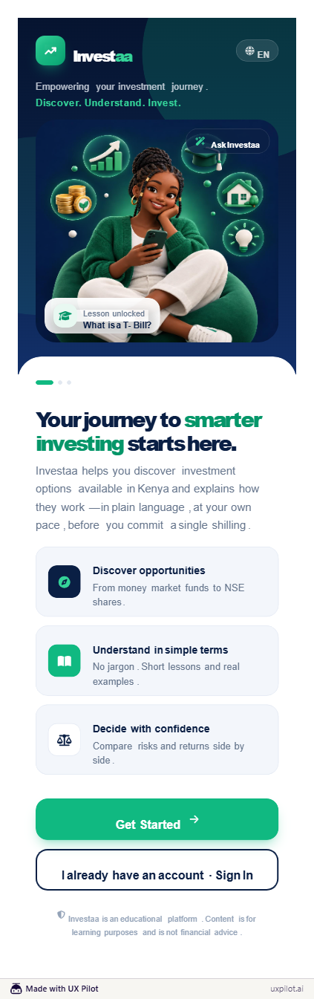
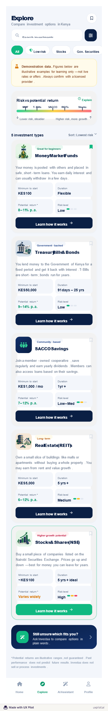
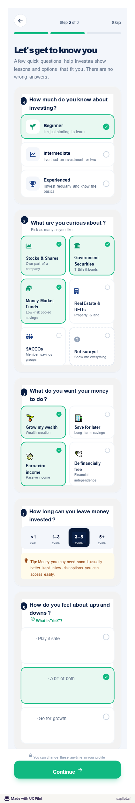
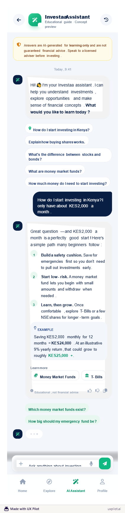

# Investaa
### Empowering Your Investment Journey.
#### *Discover. Understand. Invest.*

---

**Investaa** is an AI-powered investment discovery and guidance platform designed to make investing more accessible, understandable and approachable for everyday individuals.

Our goal is to bridge the gap between having the financial resources to invest and having the knowledge and confidence to make informed investment decisions.

We envision a platform where anyone, regardless of their financial or business background, can explore investment opportunities, understand how different markets work and discover pathways towards building long-term financial wealth.

---

## The Problem

Investing can be intimidating, particularly for individuals who have little or no background in finance.

Questions such as:

- How do I start investing?
- How does buying and selling shares work?
- How do I identify and evaluate promising companies?
- What are money market funds and government securities?
- How does real estate investment work?
- Which investment opportunities align with my financial goals?

These questions often prevent people from taking their first steps towards investing.

While many financial applications focus on budgeting, saving and managing expenses, there is an opportunity to make investment knowledge and discovery more accessible to everyday individuals.

## Our Solution

Investaa aims to simplify the investment journey through an AI-powered platform that combines financial education, investment discovery and personalized guidance.

Rather than simply telling users where to invest, the platform will help them understand their options, evaluate opportunities and make more informed decisions.

We want to make investment knowledge accessible to everyone, not just individuals with financial or business backgrounds.

## Key Features (Planned)

### 1. Investment Discovery
Explore different investment opportunities across various asset classes, including:

- Stocks and shares.
- Government securities and treasury bills.
- Money market funds.
- Real estate.
- Other accessible investment opportunities.

### 2. AI Investment Assistant
An AI-powered assistant that helps users understand investment concepts, explore opportunities and get answers to investment-related questions in simple language.

### 3. Simplified Financial Education
Break down complex financial concepts, terminology and investment processes into beginner-friendly explanations.

### 4. Investment Insights
Provide accessible information about investment opportunities, market developments, potential returns and associated risks.

### 5. Personalized Investment Guidance
Help users explore investment options based on their financial goals, interests, investment experience and risk preferences.

## Target Audience

Investaa will initially focus on the Kenyan market, particularly:

- Young adults interested in financial independence.
- First-time and beginner investors.
- Working professionals exploring investment opportunities.
- Individuals without formal financial or business education.
- Anyone interested in growing their finances beyond conventional savings.

## Vision

To create a more financially informed society where individuals have the knowledge, confidence and resources to participate in investment opportunities and make better financial decisions.

## Project Status & Roadmap

Investaa is currently in the concept and initial product design stage.

The initial UI/UX wireframes have been developed to visualise the proposed user experience, interface structure, and key platform features.

Current progress:
- [x] Concept development and problem identification
- [x] Initial product overview and feature definition
- [x] Initial UI/UX wireframes and design concepts
- [ ] Conduct market research and validate the concept.
- [ ] Define the technical architecture.
- [ ] Develop the minimum viable product (MVP).
- [ ] Test and validate with potential users.
- [ ] Explore partnerships and market introduction.

The platform is not yet a functional application. Development and validation are planned next steps.

## Product Design & Wireframes

The initial UI/UX designs provide a visual representation of Investaa's proposed interface and user experience. They explore how users could discover investment opportunities, understand different investment options, access simplified financial information, and interact with an AI-powered investment assistant.

These designs are preliminary concepts intended to guide future development.

### Design Previews

**1. Welcome Page**

**2. Explore Investments**

**3. Investment Details**

**4. AI Investment Assistant**

### Full Design Document

For a more comprehensive view of the initial designs, see the full PDF:

[**View Investaa – Initial UI/UX Design Concepts (PDF)**](design/investaa-design-concepts.pdf)

> **Note:** These are preliminary design concepts and wireframes, not screenshots of a working application. They illustrate the proposed product direction and functionality.

## Proposed Technology Direction

The following technologies and capabilities are being explored for the eventual implementation:

- **Artificial Intelligence:** AI-powered financial education and investment guidance.
- **Backend:** To be determined during technical planning.
- **Frontend:** To be determined during product design.
- **Data:** Reliable financial market and investment information sources.
- **Integration:** Potential integration with relevant financial information providers.

Technology choices will be finalized as the project progresses.

## Responsible Investment Approach

Investaa aims to promote informed financial decision-making.

The platform will prioritize transparency, explain investment risks, and distinguish educational information from personalized financial advice. Any advisory functionality will be developed with appropriate regulatory guidance and safeguards.

Investaa will not promise guaranteed returns or encourage investment decisions without an understanding of the associated risks.

## Contributing

Investaa is at an early stage, and we welcome opportunities to connect with individuals and organizations interested in financial inclusion, fintech, artificial intelligence and investment education.

## Contact

**Project:** Investaa

**Founder:** Margaret Kerubo

**Email:** neemamargaret2@gmail.com

**Location:** Kisumu, Kenya

---

*Investaa — Empowering Your Investment Journey.*
